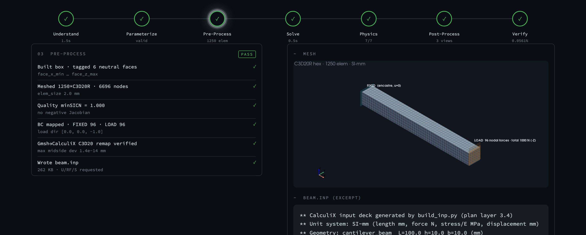
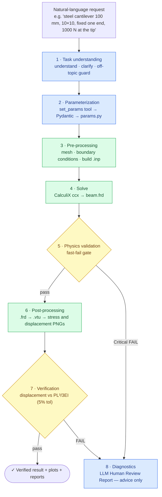
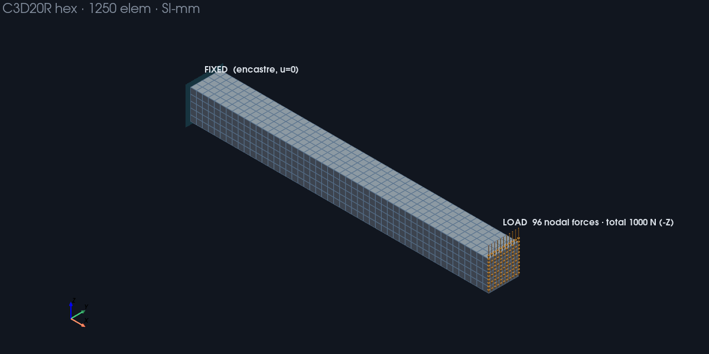
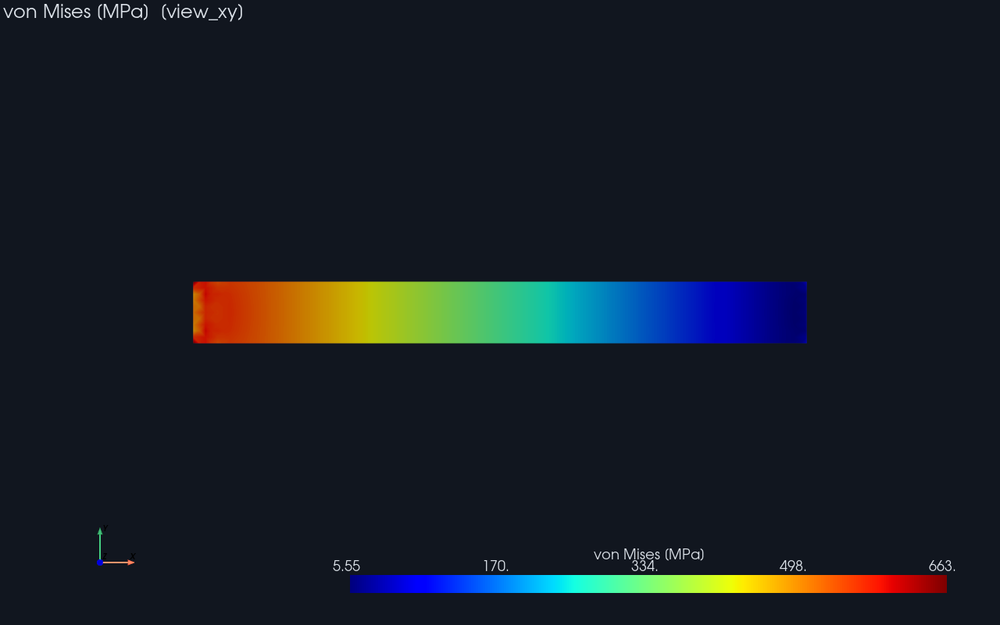
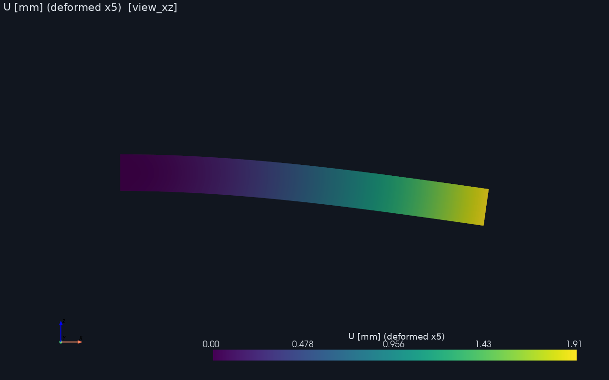
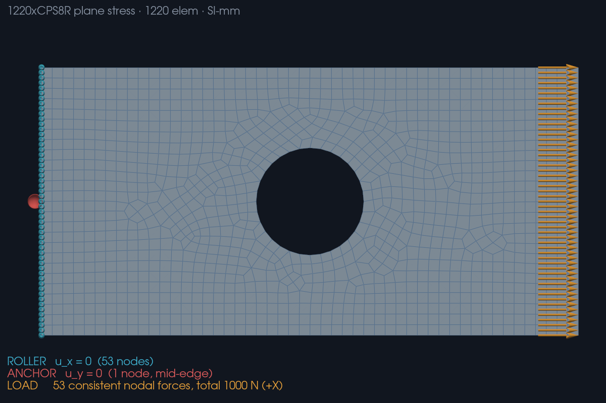
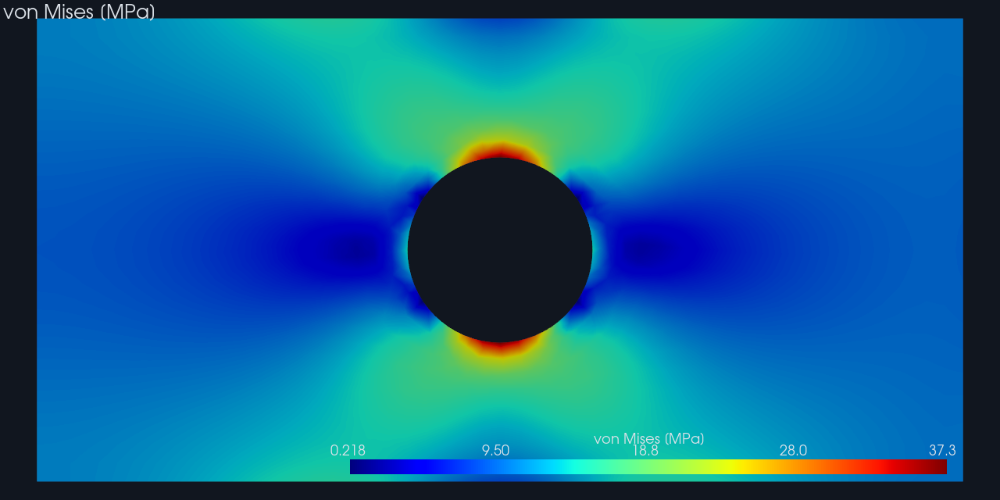
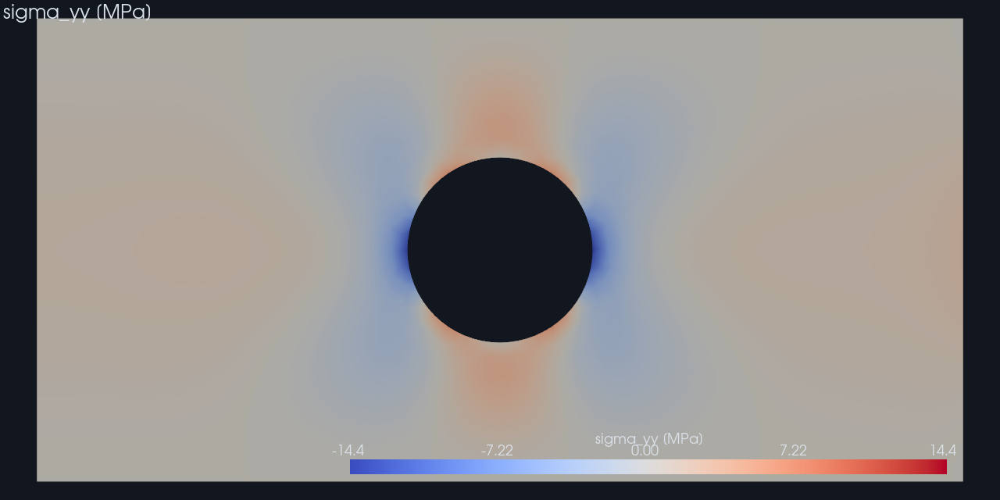

# Agentic FEA Pipeline — LLM‑driven structural analysis

Turn a plain‑English sentence into a **verified** finite‑element analysis — without ever letting the language model invent an engineering number.



*LLM agents · function calling · RAG (ChromaDB) · Gmsh + CalculiX FEA · PyVista · Streamlit · safety‑by‑architecture*

---

## What this project is (goal · problem · how it works)

This project is an **agentic pipeline that turns a natural‑language description of a structural problem into a verified finite‑element analysis (FEA)**. The problem it solves: setting up FEA is expert‑heavy and error‑prone, and while a Large Language Model can lower that barrier, an LLM **cannot be trusted to produce engineering numbers** — a plausible‑but‑wrong stress or deflection is dangerous if believed. The pipeline resolves this by drawing a hard line: the **LLM handles only semantics** (understanding the request, filling parameter slots, selecting a reference solution, explaining failures), while **deterministic code and an analytical reference guarantee every number** (mesh, solve, physics checks, error‑vs‑theory, units). One English sentence flows through **eight layers** — task understanding → parameterization → pre‑processing → CalculiX solve → physics validation → post‑processing → numerical verification → diagnostics — and out come stress/displacement plots, validation reports, and a result checked against a textbook reference solution.

Two geometries are supported, and they exercise the architecture in **opposite** ways:

| | **cantilever beam** (3D solid) | **plate with a hole** (2D plane stress) |
|---|---|---|
| Elements | C3D20R structured hex | CPS8R / CPS6, refined at the hole |
| Auto‑judged quantity | **tip deflection** vs `PL³/3EI` → **0.056 %** | **stress concentration factor** vs Howland/Peterson → **0.29 %** |
| Recorded but *not* judged | stress (the fixed‑end peak **diverges** under mesh refinement — there is no converged value to compare) | displacement (a perforated plate's elongation has **no closed form**) |

That inversion is the point: each geometry is judged on the quantity its own physics actually makes judgeable, and the system says **N/A** for the other rather than inventing a verdict.

---

## The pitch (Situation · Complication · Resolution)

- **Situation** — FEA is the workhorse of mechanical/structural engineering, but defining geometry, boundary conditions, meshes, materials and solver decks correctly takes expertise. LLMs are great at turning intent into structure.
- **Complication** — A naïve "LLM does FEA" assistant will happily hallucinate a geometry, copy a density with the wrong units, or assert a deflection it never computed. In engineering, a confident wrong number is worse than no answer.
- **Resolution** — An **agentic architecture that quarantines the LLM to semantics**. Every number is produced by deterministic code (Gmsh, CalculiX, NumPy) and judged against an analytical solution; material properties come from a curated unit‑consistent library, not the model; humans stay in the loop for decisions; the system says **N/A** instead of faking a verdict. The result is an assistant that is *helpful like an LLM and trustworthy like a solver*.

---

## Architecture — eight layers

| # | Layer | Responsibility | Owner |
|---|---|---|---|
| 1 | **Task understanding** | NL → unambiguous problem definition; off‑topic guard; ask for missing must‑haves, disclose assumed defaults | LLM (semantics) |
| 2 | **Parameterization** | Fill a `set_params` tool → Pydantic validation → `params.py`; material **name → SI‑mm library** | LLM fills · code validates |
| 3 | **Pre‑processing** | `gmsh` box + neutral face labels → FIXED/LOAD mapping → CalculiX `.inp` (incl. Gmsh→CalculiX C3D20 node remap) | deterministic code |
| 4 | **Solve** | run CalculiX `ccx`; fill the Apple‑silicon performance cores | CalculiX |
| 5 | **Physics validation** | cheap, deterministic sanity checklist (force/moment balance, displacement sign, strain energy, NaN/Inf) — a **fast‑fail gate** | deterministic code |
| 6 | **Post‑processing** | `.frd → .vtu` (ccx2paraview) → von Mises & displacement PNGs (PyVista, off‑screen) | deterministic code |
| 7 | **Numerical verification** | displacement vs analytical `δ = PL³/3EI` (< 5 %); **stress is recorded, not auto‑judged** | RAG retrieves reference · code gates + computes |
| 8 | **Diagnostics** | on any failure, an LLM root‑cause **Human Review Report** (advice only, never executes) | LLM (reasoning) |

`run_all.sh` orchestrates 3→7; if physics validation (5) fails it **skips the expensive post‑processing** and jumps to diagnostics (8).



> **Blue = LLM (semantics)** · **Green = deterministic code (numbers)** · **Yellow = validation gates.**
> The LLM never sits on a green box — that separation is the project's core safety guarantee.

---

## Design principles (the "iron laws")

These are what make the system trustworthy — and are the core of its **AI‑safety** story:

1. **The LLM never touches numerical correctness.** Every check (ΣF = 0, displacement sign, strain‑energy > 0, error vs analytical) is deterministic code. The LLM only does language: understand, fill slots, *select* a reference, *explain* a failure.
2. **Material numbers come from a curated SI‑mm library, not the model.** The LLM provides a material *name*; code looks up E/ν/ρ. (This caught a real bug where the model filled steel density as `7.85` instead of `7.85e‑9` — it dropped the exponent even when told the value.)
3. **Stress is never auto‑judged.** Fixed‑end stress concentration diverges with mesh refinement and the point load is an artificial singularity, so stress is *recorded and plotted for a human*, never given a pass/fail. The system reports **N/A** rather than a false verdict.
4. **One unit system, end‑to‑end (SI‑mm).** Magnitude guards flag suspected unit errors for a human.
5. **Mesh and boundary conditions are decoupled.** The mesh layer emits neutral geometric labels (`face_x_min`…); only the BC layer assigns FIXED/LOAD meaning.
6. **Cheap checks first, fail fast.** Physics validation gates the expensive rendering.

---

## Tech stack

- **LLM** — OpenRouter (OpenAI‑compatible API), model `openai/gpt-5.4`, **function/tool calling** with Pydantic‑generated JSON schemas; key via `.env`.
- **Validation** — Pydantic v2.
- **Geometry & mesh** — Gmsh (Python API), structured C3D20R hexahedra.
- **Solver** — CalculiX `ccx`.
- **Post‑processing** — ccx2paraview (`.frd → .vtu`), PyVista (off‑screen rendering).
- **Retrieval (RAG)** — ChromaDB vector store + OpenRouter embeddings (`openai/text-embedding-3-small`) for reference‑case / knowledge‑note retrieval; a deterministic `applies()` gate makes the final pick.
- **Dashboard** — Streamlit (a dark "control‑room" UI: live clarification chat + DEMO replay).
- **Numerics** — NumPy. **Runtime** — Python 3.12 in a conda env.

---

## Getting started

```bash
# 1) Environment (conda‑forge provides the ccx solver binary)
mamba create -n fea -c conda-forge python=3.12 calculix
conda activate fea
pip install -r requirements.txt

# 2) API key (never committed — .env is gitignored)
cp .env.example .env            # then put your OPENROUTER_API_KEY in .env

# 3) Verify the toolchain and the LLM connection
python check_env.py
python llm_check.py
```

### Run it

```bash
# LLM front end: NL → completed definition → validated params.py. Either geometry:
python parameterize.py --write \
  "A steel cantilever 100 mm long, 10×10 mm, fixed one end, 1000 N down at the free end"
python parameterize.py --write \
  "A steel plate 200x100 mm with a 20 mm radius hole in the middle, pulled with 1000 N"

# (optional) layer‑1 understanding with clarifying questions / off‑topic guard:
python task_understanding.py --parameterize "an aluminium cantilever, 100mm, 10x10, 1kN at the tip"

# Pick the geometry: params.py -> ACTIVE_CASE = "cantilever_beam" | "plate_with_hole"
# Deterministic chain: mesh → solve → physics → postprocess → verify (diagnostics on failure)
bash run_all.sh --skip-checkpoints
```

Outputs land in `out/`: `beam.{msh,inp,frd,vtu}`, the render set for the active geometry (`stress_{x,y,z}.png` for the beam, `stress_{xx,yy,xy,vm}.png` for the plate), `displacement.png`, `physics_report.txt`, `verification_report.txt`, and `diagnostic_report.txt` on failure.

Either geometry can also be driven through the in‑process orchestrator the dashboard uses, skipping the two LLM layers and running the deterministic chain on prepared parameters — the same seam the batch runner uses:

```bash
python pipeline_run.py --case plate_with_hole
```

### Regenerating the surrogate dataset

The 545‑case dataset (~540 MB of tensors) is **not** in the repository; it is regenerated from a fixed seed, which is why the sampling and meshing were made deterministic in the first place. Roughly 5 minutes:

```bash
python batch_run.py -n 500 --anchors 5 --seed 42 --root out/dataset --export --no-keep-raw
python batch_run.py -n 40 --anchors 0 --seed 2026 --root out/dataset_ood_aspect --plate 150x100 --export --no-keep-raw
python surrogate/train.py --epochs 120 --tag baseline     # ~25 min on Apple silicon (MPS)
python surrogate/evaluate.py --tag baseline
```

The `--anchors` cases are deliberately centred holes: they are the only configurations an analytical reference applies to, so they act as **control samples** that audit the whole batch against Howland's solution (5/5 within 0.93 % on the run reported here). Model weights are gitignored — `surrogate/runs/baseline/per_case.csv` carries the per‑case results that back the table above.

### Dashboard (Streamlit)

```bash
streamlit run app.py             # live: type a problem, watch the 8 layers run, click any stage
DEMO_MODE=1 streamlit run app.py # replay recorded runs — no API key, no solver needed
```

A dark "control‑room" UI. A clarification chat resolves the request (asks for missing must‑haves, guards scope), then a clickable eight‑stage bar walks the run: the **left** panel is the action flow, the **right** panel holds the artifacts — an annotated mesh (FIXED/LOAD read straight from the `.inp`), stress/displacement plots, the RAG‑selected reference, and the acceptance reports. DEMO mode replays the snapshots in `demo/` — including the opening clarification dialogue — so it runs with no key and no solver.

---

## Validation & results

- **Tip deflection vs analytical:** 1.9058 mm (FEM) vs 1.9048 mm (Euler–Bernoulli `PL³/3EI`) → **0.056 % error** (tolerance 5 %).
- **Physics sanity:** force balance residual 0.000 %, moment balance 0.000 %, strain energy > 0, displacement downward — all pass.
- **Diagnostics, validated on an induced failure:** a stubby beam (L/h = 2) makes the FEM deflection exceed beam theory by ~20 %; the agent correctly diagnoses *"Euler–Bernoulli invalid for a non‑slender beam — transverse shear, not a solver or mesh bug,"* with high confidence and a sound fix — it never executes anything.

| annotated mesh + BCs | von Mises stress | deformed shape (×5) |
|---|---|---|
|  |  |  |

*(Figures are the committed DEMO snapshots in `demo/cantilever_pass/`; live runs regenerate them into `out/`.)*

### Plate with a hole — 2D plane stress

A rectangular plate `a × b × t` with a circular hole of radius `r` at `(xc, yc)`, pulled by a total force `F`. The support model is a **roller plus a single mid‑edge anchor**, not a clamp: clamping would forbid the Poisson contraction and manufacture a *singular* corner stress that never converges, poisoning both the peak‑stress verdict and any field data taken from the run.

- **Stress concentration vs theory:** `Kt` = 2.2395 (FEM) vs 2.2330 (Howland/Peterson net‑section fit) → **0.29 % error** (tolerance 3 %).
- **Tolerance set by measurement, not guesswork:** sweeping the hole radius across the whole design range (`2r/b` from 0.16 to 0.60) puts the worst deviation at 0.59 %, against a reference fit whose own stated accuracy is ~1 %.
- **Mesh convergence:** refining 32 → 64 → 126 elements around the hole moves `Kt` 2.2395 → 2.2441 → 2.2471 while the free‑surface traction residual falls 6.2 % → 2.7 % → 0.7 %. The peak converges to a finite value — which is exactly the property that makes stress auto‑judgeable here and not on the beam.
- **Honest N/A:** move the hole off‑centre and the reference stops applying; the `applies()` gate reports **N/A** and records the measured `Kt` instead of fabricating a verdict.

| mesh + roller/anchor/load | von Mises | σ_yy (compression at the hole flanks) |
|---|---|---|
|  |  |  |

The middle figure peaks exactly where Kirsch's classical solution says it must — on the transverse diameter, `θ = ±90°`. The right‑hand figure is the corroborating signature: σ_yy goes **compressive** at the hole's left and right flanks under a purely tensile load.

### CNN stress‑field surrogate

The verified pipeline then becomes a **data generator**: 545 plate cases, every one of them cleared through the same physics gates, exported as regular‑grid tensors and used to train a UNet that predicts the stress field directly from the geometry.

| split | n | field nRMSE | Kt error vs FEA | Kt bias |
|---|---|---|---|---|
| test (held out) | 62 | **1.00 %** | 4.58 % | −4.58 % |
| OOD — larger holes than trained on | 92 | 3.06 % | 6.10 % | −6.08 % |
| OOD — a plate proportion never seen | 40 | **25.73 %** | 21.97 % | +18.93 % |

Three things this table is meant to be honest about:

- **The peak error decomposes.** Of the 4.58 % on Kt, about 3.0 % is the pixel grid's own representation floor — the peak sits exactly on the hole boundary, where no pixel centre can sit — and only ~2.2 % is the network. The true FEA peak is stored with every case precisely so that split can be shown rather than assumed.
- **A 1 % field error does not mean a 1 % answer.** The five worst test cases have field errors of 0.5–1.0 % and Kt errors up to 14.5 %. The peak occupies ~0.04 % of the pixels, so a plain field loss barely notices it; the model under‑predicts peaks systematically, as convolutional smoothing predicts.
- **It fails silently outside its envelope.** On a plate proportion it never trained on, the model invents stress patterns that are not there and flips from under‑ to over‑prediction. The equilibrium residual — a physics check deliberately kept *out* of the loss — does rise on those cases, so it works as a trust signal without ground truth, though it is coarse enough to miss the milder extrapolation failure.

Kt and the equilibrium residual were kept out of the training objective on purpose: a metric you have optimised is no longer independent evidence.

📄 **[Full surrogate report](docs/surrogate_review.html)** — dataset construction, metric definitions, failure analysis and limits.

---

## Ethics & privacy

- **Safety by architecture.** The central design choice — *the LLM never produces or judges an engineering number* — directly mitigates the main risk of LLMs in engineering: a fluent, confident, wrong result that a user might trust. Correctness is owned by deterministic solvers and analytical references.
- **Human‑in‑the‑loop.** Diagnostics only advises; it never modifies inputs or re‑runs anything. An unknown material **halts and asks** the human to define it rather than guessing. Off‑topic requests are declined.
- **Honesty over false confidence.** Stress is reported as **N/A** with the reason, not a fake pass; when no analytical reference applies the verdict is **N/A**; assumed defaults are disclosed explicitly.
- **Privacy / secrets.** API keys are read only from the environment (`.env`, gitignored); they are never hard‑coded or logged (only the key *length* is printed by the connectivity check).
- **Stated limitations.** Linear‑elastic, small‑strain. Two geometries: the tip‑loaded cantilever (slender‑beam scope; stress not auto‑verified) and the plane‑stress plate with a hole (thin‑plate scope; displacement not auto‑verified, and the SCF reference applies only to a reasonably centred hole). The plate supports exactly one circular hole under uniaxial tension — its support model is fixed by the pipeline, and that is disclosed as an assumption rather than silently applied.

---

## Repository layout

```
params.py                       # validated parameters — single source of truth
schema.py                       # Pydantic validation (+ SI‑mm magnitude guards)
task_understanding.py           # layer 1 — NL understanding / clarification
parameterize.py                 # layer 2 — set_params tool (LLM) → validate → params.py
knowledge/
  materials.py                  # SI‑mm materials library (name → E/ν/ρ)
  reference_solutions.py        # analytical reference cases (verification)
  knowledge_notes.py            # failure‑pattern / modelling notes (RAG corpus)
  vector_store.py               # ChromaDB index + embeddings (semantic retrieval)
mesh.py · boundary_conditions.py · build_inp.py   # layer 3 — pre‑processing
solve.sh                        # layer 4 — CalculiX
physics_validation.py           # layer 5 — fast‑fail sanity gate
postprocess.py                  # layer 6 — .vtu + PNG renders (PyVista)
verification.py                 # layer 7 — RAG‑retrieved reference, deterministic error
diagnostics.py                  # layer 8 — LLM root‑cause advisor (RAG‑augmented)
batch_run.py                    # M10 — batch the design space, one manifest row per case
export_field.py                 # M11 — FE solution -> regular-grid tensors (.npz)
surrogate/                      # M12 — the CNN: dataset / model / train / evaluate
run_all.sh                      # CLI orchestration (deterministic chain)
app.py                          # Streamlit dashboard (live chat + DEMO replay)
pipeline_run.py                 # in‑process orchestrator behind the dashboard
render_mesh.py                  # annotated mesh figure from the .inp (PyVista)
record_demo.py · record_chat.py # record demo/ run snapshots + clarification threads
demo/                           # pre‑recorded runs + chat for DEMO_MODE (no key needed)
.streamlit/                     # dashboard theme config
llm_config.py · llm_check.py · check_env.py        # config & health checks
```

Design rationale lives with the thing it justifies: each measured threshold
carries its own evidence in the comment next to it — the ligament meshing rule
in `mesh.py`, the traction normalisation in `physics_validation.py`, the grid
resolution in `export_field.py`, the SCF tolerance in `params.py`.

---

## Roadmap

**Delivered since the MVP:**

- ✅ **Retrieval‑augmented reference selection** — semantic retrieval over a ChromaDB vector store (reference solutions, material notes, failure patterns); a deterministic `applies()` gate still makes the final pick and diagnostics is RAG‑augmented. The "agent retrieves, code decides" seam keeps the iron law intact (it gracefully falls back to a deterministic scan if retrieval is unavailable).
- ✅ **Streamlit dashboard** — a dark "control‑room" front end: a clarification chat resolves the request, then a clickable eight‑stage walkthrough shows the action flow, annotated mesh, plots, the RAG‑selected reference and acceptance reports. Live mode runs the real pipeline; DEMO mode replays recorded snapshots with no key or solver.
- ✅ **Second geometry — 2D plane‑stress plate with a hole** — proving the architecture generalises rather than being one hard‑coded problem. Every layer dispatches on `geometry.type`, the naming contract and the iron laws are unchanged, and the plate flips *which* quantity is auto‑judged (stress, not displacement) because its physics differs. Both geometries run end to end from one `run_all.sh`.

- ✅ **CNN stress‑field surrogate** — 545 cases batched over the `(r, xc, yc)` design space, exported to a regular grid, and used to train a UNet that predicts the field directly. Every case cleared the same physics gates before its field was allowed into the training set, and the held‑out sets were fixed at generation time so the out‑of‑distribution result means what it says.

**Next:**

- **Close the peak gap** — the model under‑predicts peak stress by ~4.6 %. A magnitude‑weighted loss is the obvious next experiment, with the current run as the baseline to beat.
- **Widen the envelope** — training across plate proportions, to find out whether the out‑of‑distribution collapse is a data problem or a capacity one.
- **Stage 2 — nonlinearity** — geometric (`NLGEOM`) and material (`*PLASTIC`) nonlinearity; verification evolves from "vs analytical" to "vs linear baseline" (hook reserved).

---

*A personal project on pairing LLM agents with deterministic engineering so the result is both accessible and trustworthy. (Originated as an Advanced LLM Application capstone.)*
